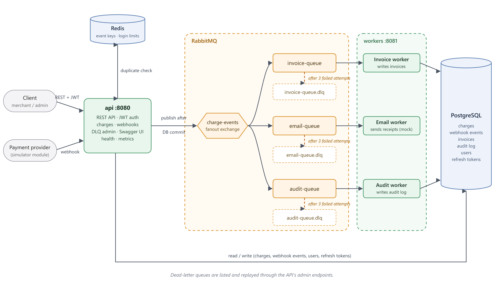

# Billing & Payment Orchestration Platform

An event-driven billing backend built with Spring Boot. It creates charges, receives payment results from a (simulated) payment provider through webhooks, and fans each confirmed or failed payment out to independent workers that issue invoices, send receipts and keep an audit trail.

The interesting part is what happens when things go wrong: duplicate webhooks, a crashing worker, a message that can never be processed, a restarted broker. The platform handles each of these deliberately and has tests that prove it against real PostgreSQL, RabbitMQ and Redis instances.



## How a payment flows

1. A client creates a charge through the REST API (`POST /charges`). It starts as `PENDING`.
2. The payment provider reports the outcome by calling `POST /webhooks/payment-provider`.
3. The API checks the event hasn't been seen before, updates the charge to `CONFIRMED` or `FAILED`, and publishes a `ChargeEvent` to RabbitMQ. The publish happens only if the database transaction commits. An event for a charge that is already settled is acknowledged and ignored if it reports the same outcome, and rejected with `409` if it contradicts it.
4. A fanout exchange copies the event to three queues. Each worker consumes its own queue independently:
   - **Invoice worker** creates a numbered invoice for a confirmed charge.
   - **Email worker** sends a payment receipt (mocked: it logs the email).
   - **Audit worker** records every event with its full payload.
5. A worker that keeps failing on a message gives up after three attempts, and the message moves to that worker's dead-letter queue. An admin can inspect it and replay it through the API.

## Quick start

**Requirements:** Java 17, Docker. Maven is provided by the wrapper (`./mvnw`).

```bash
# 1. Start PostgreSQL, RabbitMQ and Redis
docker compose up -d

# 2. Build everything and install the shared module
./mvnw clean install -DskipTests

# 3. Set a signing secret for tokens (the API refuses to start without one)
export JWT_SECRET=$(openssl rand -base64 48)      # PowerShell: $env:JWT_SECRET = [Convert]::ToBase64String((1..48 | % { Get-Random -Max 256 }))

# 4. Start the API (creates the database schema on first start) - terminal 1
./mvnw -pl api spring-boot:run

# 5. Start the workers - terminal 2
./mvnw -pl workers spring-boot:run
```

Start the API first: it owns the database schema, and the workers only validate it.

Once running:

| What | Where |
|---|---|
| API | http://localhost:8080 |
| API documentation (Swagger UI) | http://localhost:8080/swagger-ui.html |
| Health | http://localhost:8080/actuator/health |
| RabbitMQ management UI | http://localhost:15672 (`guest` / `guest`) |

### Try it

Two users are seeded for local development: `admin` / `admin123` and `merchant` / `merchant123`.

```bash
# Log in and keep the access token
TOKEN=$(curl -s -X POST http://localhost:8080/auth/login \
  -H "Content-Type: application/json" \
  -d '{"username":"merchant","password":"merchant123"}' | jq -r .accessToken)

# Create a charge (amount is in minor units: 2500 = 25.00 USD, the only supported currency)
curl -s -X POST http://localhost:8080/charges \
  -H "Authorization: Bearer $TOKEN" -H "Content-Type: application/json" \
  -d '{"customerRef":"cust-001","amount":2500,"currency":"USD"}'
# -> {"id":"<charge-id>", ..., "status":"PENDING", ...}

# Have the simulated payment provider confirm it
./mvnw -q -pl simulator exec:java -Dexec.args="--charge <charge-id>"

# The charge is now CONFIRMED; the workers log the invoice, receipt and audit entry
curl -s http://localhost:8080/charges/<charge-id> -H "Authorization: Bearer $TOKEN"
```

On Windows PowerShell, use `curl.exe` instead of `curl`, and put JSON bodies in a file (`-d "@body.json"`), because PowerShell rewrites quotes inside inline JSON.

### Payment provider simulator

The `simulator` module stands in for the provider and calls the real webhook endpoint over HTTP. It can also misbehave on purpose:

```
--charge <uuid>      charge the webhook is about (required)
--outcome <value>    SUCCEEDED (default) or FAILED
--delay <seconds>    wait before sending
--duplicates <n>     extra copies of the same event
--simultaneous       send all copies at the same instant
--event-id <id>      event id to use (default: random)
--url <base-url>     API address (default http://localhost:8080)
```

For example, `--duplicates 4 --simultaneous` sends five identical webhooks at once. Exactly one is processed; the rest are acknowledged and ignored.

## API overview

| Endpoint | Access | Purpose |
|---|---|---|
| `POST /auth/login` | public | Exchange credentials for an access and a refresh token |
| `POST /auth/refresh` | public | Exchange a refresh token for a new pair (the old one is used up) |
| `POST /auth/logout` | public | End the session a refresh token belongs to |
| `POST /charges`, `GET /charges`, `GET /charges/{id}` | any logged-in user | Create, list (paged) and fetch charges |
| `POST /webhooks/payment-provider` | public | Payment provider callback |
| `POST /admin/users` | `ADMIN` | Create a user (`ADMIN` or `MERCHANT`) |
| `GET /admin/dlq/{worker}` | `ADMIN` | List dead-lettered messages (`invoice`, `email` or `audit`) |
| `POST /admin/dlq/{worker}/replay/{messageId}` | `ADMIN` | Send one dead-lettered message back to its worker |
| `/actuator/health/**` | public | Health, liveness and readiness |
| `/actuator/**` (everything else) | `ADMIN` | Metrics and info |

Tokens are signed JWTs: access tokens last 15 minutes, refresh tokens 7 days. Send the access token as `Authorization: Bearer <token>`. The full request and response schemas are in the Swagger UI, which has an **Authorize** button.

## Authentication and sessions

- **Refresh tokens are single-use.** Every refresh returns a new access token *and* a new refresh token, and the old refresh token stops working. The server keeps a record of each one (never the token itself), so tokens can be revoked.
- **Stolen tokens are detected.** If a refresh token that was already used is presented again, someone is replaying a copy. The server ends that whole session (every token descended from that login) and answers `401`. Other logins of the same user are unaffected.
- **Logout is real.** `POST /auth/logout` with a refresh token ends its session. Logging out twice, or with an unknown token, is harmless and looks the same from outside. An access token that was already issued stays valid until it expires, at most 15 minutes.
- **Guessing passwords is limited.** After 5 failed logins for one username from one client address within 15 minutes, login answers `429` with a `Retry-After` header, even for the correct password. Unknown usernames are limited exactly like real ones, so the limit can't be used to find accounts. Counters live in Redis; if Redis is down, logins still work but are not limited.
- **Usernames are case-insensitive.** `Admin` and `admin` are the same account; names are stored in lower case.

## Reliability

**Duplicate webhooks are processed once.** Providers retry, so the same event can arrive many times, sometimes simultaneously. Two layers guard against that: a fast check in Redis for recently seen event IDs, and a unique constraint in PostgreSQL that rejects the duplicate even when two copies race past the Redis check. A duplicate gets a normal `200`, so the provider stops retrying.

**No event without a commit.** The event is published inside the same transaction as the charge update. If the database transaction rolls back, the message never reaches the broker.

**Workers are isolated.** Each worker has its own queue, so a failing or slow worker can't hold up the others. A redelivered message is harmless: the invoice worker skips a charge that already has an invoice, and the audit worker skips an event it has already recorded.

**Retries, then dead letters.** Each worker makes three attempts per message, waiting 1 second and then 2 seconds between them. A message that still fails is dead-lettered to that worker's `<queue>.dlq`, where it stays until someone looks at it. Replaying it sends it back to the worker's own queue, so one worker's replay never touches the others.

## Observability

- **Health:** `/actuator/health` reports PostgreSQL, RabbitMQ and Redis separately (the per-component detail needs an `ADMIN` token). `/actuator/health/liveness` and `/actuator/health/readiness` are meant for orchestrators.
- **Logs:** readable text by default. With the `prod` profile (`SPRING_PROFILES_ACTIVE=prod`) every line is one JSON object, ready for a log aggregator.
- **Correlation IDs:** every request gets an ID, taken from the `X-Correlation-Id` header or generated, and returned in the response. It travels with the message through RabbitMQ, so one charge can be followed from the HTTP request to the worker log lines it caused. It appears in brackets after the log level, or as a `correlationId` field in JSON logs.
- **Queue metrics:** `GET /actuator/metrics/billing.queue.messages` (admin token) reports how many messages are waiting in each work queue and each dead-letter queue. Filter with tags, for example `?tag=kind:dead-letter`. A queue that doesn't exist reports `NaN`, not 0.

## Configuration

Defaults point at the services in `docker-compose.yml`, so nothing is required locally. These matter beyond local use:

| Setting | Purpose |
|---|---|
| `JWT_SECRET` | **Required.** Signing key for tokens, at least 32 bytes of random data (`openssl rand -base64 48`). The API refuses to start without it. Changing it logs everyone out. |
| `SPRING_PROFILES_ACTIVE=prod` | JSON logging |
| `app.auth.max-login-failures`, `app.auth.login-failure-window` | Login limit (default 5 failures per 15 minutes) |
| `spring.datasource.*`, `spring.rabbitmq.*`, `spring.data.redis.*` | Connection settings, in each module's `application.yml` |

## Tests

```bash
./mvnw verify
```

Docker must be running: the integration tests start real PostgreSQL, RabbitMQ and Redis containers with Testcontainers, so what they prove holds against the real thing. They cover, among others, concurrent duplicate webhooks, retry and dead-lettering, DLQ replay, worker isolation, authentication and authorization rules, health reporting, JSON logging and correlation across the broker. GitHub Actions runs the same build on every pull request.

## Project layout

| Module | Role |
|---|---|
| `common` | Shared entities, event types, messaging constants, dead-letter operations, logging configuration, database migrations |
| `api` | REST API, authentication, webhook handling, admin endpoints, publishing |
| `workers` | The three queue consumers, with retry and dead-lettering |
| `simulator` | Command-line stand-in for the payment provider |

**Stack:** Java 17, Spring Boot 3.3, Spring Security with JWT, Spring Data JPA and Hibernate, Flyway, PostgreSQL 16, RabbitMQ 3.13, Redis 7, Resilience4j, Micrometer, springdoc-openapi, Testcontainers, JUnit 5, Maven, GitHub Actions.
